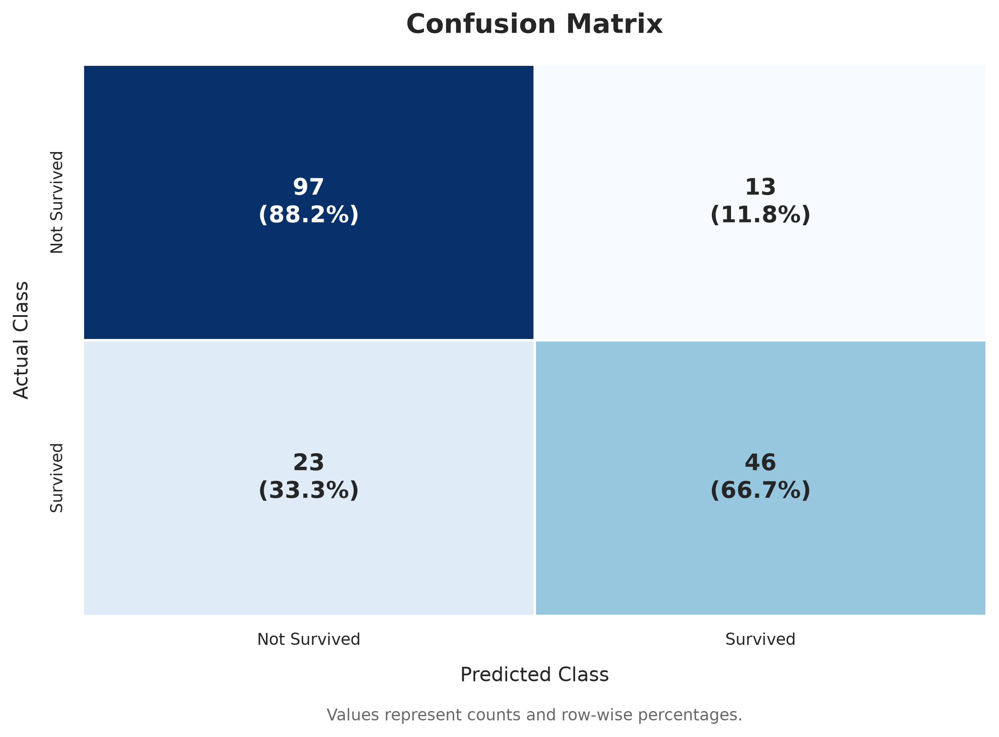
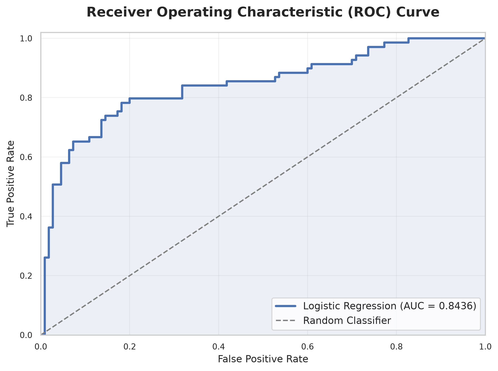
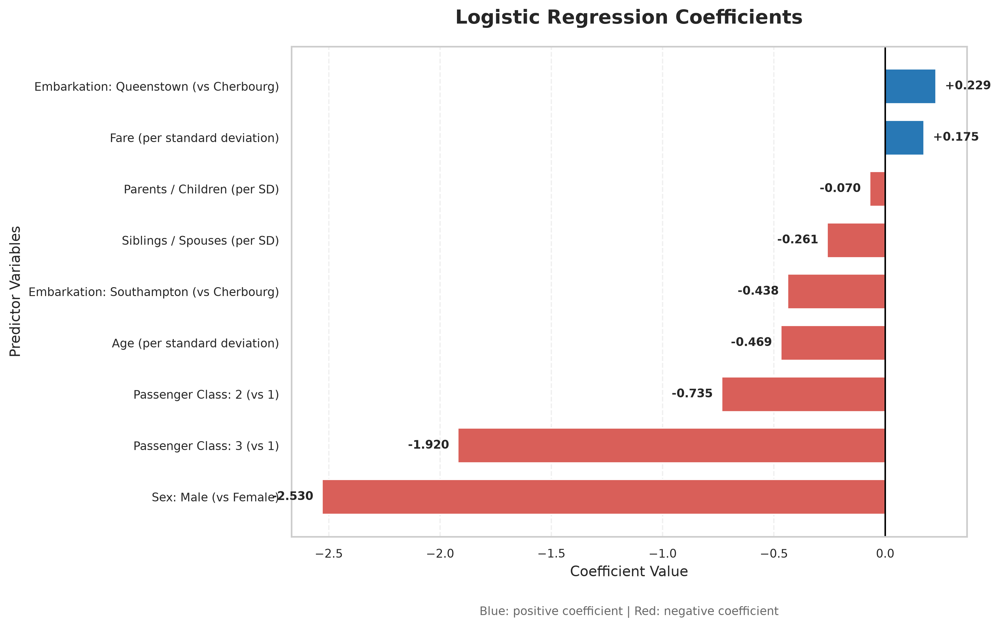

# TITANIC — EXPLORATORY DATA ANALYSIS, STATISTICAL ANALYSIS AND PREDICTIVE MODELING

## 1. Introduction

The sinking of the RMS Titanic in April 1912 is one of the most famous maritime disasters in history.

This project aims to analyze passenger data from the Titanic dataset to identify patterns and relationships between passenger characteristics and survival outcomes.

The project is divided into three main parts:

- **Exploratory Data Analysis (EDA):** understanding the dataset and identifying relevant patterns.
- **Statistical Analysis:** investigating relationships between passenger characteristics and survival using statistical methods.
- **Predictive Modeling:** developing and evaluating a Logistic Regression model to predict passenger survival.

The overall objective is to demonstrate a complete data science workflow, from data exploration to predictive modeling and model evaluation.

## 2. Dataset Description

The dataset used in this project is the Titanic dataset provided by Seaborn.

It contains:

- **891 observations**
- **15 variables**

The dataset includes information about passengers, such as:

| Variable | Description |
|---|---|
| survived | Survival status (0 = No, 1 = Yes) |
| pclass | Passenger class (1st, 2nd, 3rd) |
| sex | Passenger gender |
| age | Passenger age |
| sibsp | Number of siblings or spouses aboard |
| parch | Number of parents or children aboard |
| fare | Passenger fare |
| embarked | Port of embarkation |

The target variable used for predictive modeling is `survived`.

## 3. Exploratory Data Analysis (EDA)

### 3.1 Survival Distribution

The dataset contains 342 survivors and 549 non-survivors.

This corresponds to:

- **38.38%** survived.
- **61.62%** did not survive.

The distribution indicates that non-survivors represent the majority of passengers.

### 3.2 Survival by Gender

Survival rates differ considerably between female and male passengers.

| Gender | Survivors | Total | Survival Rate |
|---|---:|---:|---:|
| Female | 233 | 314 | 74.20% |
| Male | 109 | 577 | 18.89% |

Female passengers had a substantially higher observed survival rate than male passengers.

### 3.3 Survival by Passenger Class

Survival rates also vary according to passenger class.

| Passenger Class | Survival Rate |
|---|---:|
| First Class | 62.96% |
| Second Class | 47.28% |
| Third Class | 24.24% |

Passengers travelling in first class had the highest observed survival rate, while third-class passengers had the lowest.

### 3.4 Survival by Gender and Passenger Class

Combining gender and passenger class reveals additional differences.

| Gender | Passenger Class | Survivors | Total | Survival Rate |
|---|---|---:|---:|---:|
| Female | First | 94 | 97 | 96.81% |
| Female | Second | 76 | 82 | 92.68% |
| Female | Third | 72 | 144 | 50.00% |
| Male | First | 45 | 122 | 36.89% |
| Male | Second | 17 | 108 | 15.74% |
| Male | Third | 47 | 347 | 13.54% |

These results highlight the substantial differences in survival rates across gender and passenger class.

### 3.5 EDA Visualizations

The following visualizations illustrate the main patterns identified during exploratory data analysis.

**Survival Distribution**


**Survival Rate by Gender**


**Survival Rate by Passenger Class**


## 4. Conditional Probability Analysis

Conditional probabilities were calculated to investigate survival rates according to passenger characteristics.

The conditional probability of survival given a characteristic \(A\) is:

\[
P(Survived \mid A)=
\frac{P(Survived \cap A)}{P(A)}
\]

The results show:

| Condition | Conditional Probability |
|---|---:|
| Female | 74.20% |
| Male | 18.89% |
| First Class | 62.96% |
| Second Class | 47.28% |
| Third Class | 24.24% |

These results confirm that gender and passenger class are strongly associated with survival outcomes in the dataset.

## 5. Contingency Table Analysis

A contingency table was constructed to examine the relationship between gender and survival.

| Gender | Did Not Survive | Survived | Total |
|---|---:|---:|---:|
| Female | 81 | 233 | 314 |
| Male | 468 | 109 | 577 |
| **Total** | **549** | **342** | **891** |

The table reveals a considerable difference in survival outcomes between female and male passengers.

## 6. Chi-Square Test of Independence

A Chi-Square Test of Independence was conducted to determine whether gender and survival are statistically associated.

The hypotheses were:

- **Null Hypothesis (H₀):** Gender and survival are independent.
- **Alternative Hypothesis (H₁):** Gender and survival are associated.

The test produced the following results:

| Statistic | Value |
|---|---:|
| Chi-Square Statistic | 260.717 |
| Degrees of Freedom | 1 |
| P-value | 1.20 × 10⁻⁵⁸ |
| Cramer's V | 0.5409 |

Since the p-value is considerably smaller than 0.05, the null hypothesis is rejected.

There is strong statistical evidence of an association between gender and survival in the Titanic dataset.

Cramer's V also indicates a substantial association between these two variables.

## 7. Predictive Modeling — Logistic Regression

### 7.1 Objective

After completing the exploratory and statistical analyses, a Logistic Regression model was developed to predict whether a passenger survived the Titanic disaster.

The problem is formulated as a binary classification task:

- `0`: Did not survive.
- `1`: Survived.

Logistic Regression was selected because it is a widely used classification algorithm that estimates the probability of an observation belonging to a particular class.

### 7.2 Feature Selection

Seven explanatory variables were selected:

- `sex`
- `pclass`
- `age`
- `fare`
- `sibsp`
- `parch`
- `embarked`

The target variable is `survived`.

### 7.3 Data Preprocessing

A preprocessing pipeline was implemented using Scikit-learn.

**Numerical Features**

The following transformations were applied:

1. Missing values were replaced using the median.
2. Features were standardized using `StandardScaler`.

**Categorical Features**

The following transformations were applied:

1. Missing values were replaced using the most frequent category.
2. Categorical variables were encoded using `OneHotEncoder`.
3. `drop="first"` was used to avoid redundant dummy-variable encoding.

The preprocessing steps were integrated into a `ColumnTransformer` and a Scikit-learn Pipeline.

This approach ensures that preprocessing transformations are fitted on the training data rather than on the entire dataset, helping prevent data leakage.

### 7.4 Train-Test Split

The dataset was divided into training and testing sets.

| Dataset | Number of Observations |
|---|---:|
| Training Set | 712 |
| Testing Set | 179 |
| Total | 891 |

The split was performed using:

- `test_size=0.2`
- `random_state=42`
- `stratify=y`

Stratification preserves approximately the same target-class proportions in both subsets.

### 7.5 Model Training

The Logistic Regression model was implemented using Scikit-learn.

The model was trained on the training dataset after preprocessing.

Predictions were generated on the test dataset, and predicted probabilities were used to evaluate the model's discrimination performance.

The default classification threshold of 0.5 was used to convert predicted probabilities into binary predictions.

## 8. Model Evaluation

### 8.1 Classification Performance

The model was evaluated using Accuracy, Precision, Recall and F1-score.

The results are presented below:

| Metric | Non-Survivors (0) | Survivors (1) |
|---|---:|---:|
| Precision | 0.81 | 0.78 |
| Recall | 0.88 | 0.67 |
| F1-score | 0.84 | 0.72 |
| Support | 110 | 69 |

**Overall Accuracy: 79.89%**

The model correctly classified approximately 80% of the passengers in the test dataset.

The recall for survivors is lower than the recall for non-survivors. This indicates that the model misses a proportion of passengers who actually survived.

### 8.2 Confusion Matrix

The confusion matrix provides a detailed view of the model's classification results.



The matrix contains:

| Classification Outcome | Value |
|---|---:|
| True Negatives | 97 |
| False Positives | 13 |
| False Negatives | 23 |
| True Positives | 46 |

Interpretation:

- **97 True Negatives:** passengers who did not survive and were correctly classified.
- **13 False Positives:** passengers who did not survive but were predicted to survive.
- **23 False Negatives:** passengers who survived but were predicted not to survive.
- **46 True Positives:** passengers who survived and were correctly classified.

The model correctly identified 66.7% of actual survivors.

### 8.3 ROC Curve and AUC

The Receiver Operating Characteristic (ROC) curve was used to evaluate the model's ability to distinguish between survivors and non-survivors across different classification thresholds.



The Area Under the Curve (AUC) obtained on the test dataset is:

**ROC-AUC = 0.8436**

An AUC of approximately 0.84 indicates good discrimination performance.

The model performs substantially better than a random classifier, represented by the diagonal reference line.

### 8.4 Cross-Validation

To evaluate the stability of the model, a Stratified 5-Fold Cross-Validation was performed on the training dataset.

The ROC-AUC scores obtained were:

```text
[0.8559, 0.8247, 0.8772, 0.8307, 0.8746]
```

Summary:

| Metric | Value |
|---|---:|
| Mean ROC-AUC | 0.8526 |
| Standard Deviation | 0.0217 |

The relatively low standard deviation indicates that the model's discrimination performance was reasonably consistent across the five validation folds.

The cross-validation results are close to the ROC-AUC obtained on the independent test dataset.

### 8.5 Logistic Regression Coefficients

The coefficients of the trained Logistic Regression model were extracted to examine the relationship between the explanatory variables and the predicted survival probability.

The coefficients were converted into Odds Ratios using:

\[
OR=e^{\beta}
\]

Where:

- \(\beta\) represents the Logistic Regression coefficient.
- \(OR\) represents the corresponding Odds Ratio.

The results are presented below:

| Feature | Coefficient | Odds Ratio |
|---|---:|---:|
| Embarked: Queenstown | 0.2287 | 1.2569 |
| Fare | 0.1747 | 1.1909 |
| Parents / Children | -0.0699 | 0.9325 |
| Siblings / Spouses | -0.2607 | 0.7705 |
| Embarked: Southampton | -0.4305 | 0.6503 |
| Age | -0.4689 | 0.6257 |
| Passenger Class: Second | -0.7349 | 0.4796 |
| Passenger Class: Third | -1.9197 | 0.1467 |
| Sex: Male | -2.5290 | 0.0797 |

**Interpretation**

- **Sex:** The negative coefficient for male passengers indicates lower estimated survival odds compared with female passengers, holding the other model features constant.
- **Passenger Class:** Second- and third-class passengers have lower estimated survival odds than first-class passengers.
- **Age:** The negative coefficient indicates that an increase of one standard deviation in age is associated with lower estimated survival odds.
- **Fare:** The positive coefficient indicates that an increase of one standard deviation in fare is associated with higher estimated survival odds.

For categorical variables, the comparisons are made against their reference categories:

- Female for gender.
- First class for passenger class.
- Cherbourg for embarkation port.

For numerical variables, the coefficients represent the effect associated with a one-standard-deviation increase because these variables were standardized.

These coefficients describe conditional associations estimated by the model. They should not be interpreted as causal effects.

### 8.6 Coefficient Visualization

The horizontal bar chart provides a visual representation of the Logistic Regression coefficients.



Positive coefficients are associated with higher estimated log-odds of survival, while negative coefficients are associated with lower estimated log-odds.

The visualization highlights the importance of gender and passenger class in the model's predictions.

## 9. General Conclusion

This project explored the Titanic dataset through exploratory data analysis, statistical analysis and predictive modeling.

The exploratory analysis revealed substantial differences in survival rates according to gender and passenger class.

The Chi-Square Test of Independence provided strong statistical evidence of an association between gender and survival.

A Logistic Regression model was then developed using seven explanatory variables.

The model achieved:

- **79.89% Accuracy**
- **0.8436 Test ROC-AUC**
- **0.8526 Mean Cross-Validation ROC-AUC**

The results indicate that Logistic Regression provides a useful baseline model for predicting passenger survival.

However, the model does not identify all survivors correctly, as demonstrated by its survivor recall of 66.7%.

Further improvements could include:

- Optimizing the classification threshold.
- Engineering additional features.
- Comparing Logistic Regression with Decision Trees, Random Forests and Support Vector Machines.
- Evaluating model calibration and additional classification metrics.
- Investigating model interpretability and generalization.

Overall, this project demonstrates a complete introductory data science workflow, combining data exploration, statistical inference, machine learning and model evaluation.

## 10. Technologies Used

The following tools and libraries were used:

- **Python**
- **Pandas** — Data manipulation and analysis.
- **NumPy** — Numerical computations.
- **Seaborn** — Statistical data visualization and dataset loading.
- **Matplotlib** — Data visualization.
- **Scikit-learn** — Data preprocessing, Logistic Regression, cross-validation and model evaluation.
- **Git and GitHub** — Version control and project hosting.