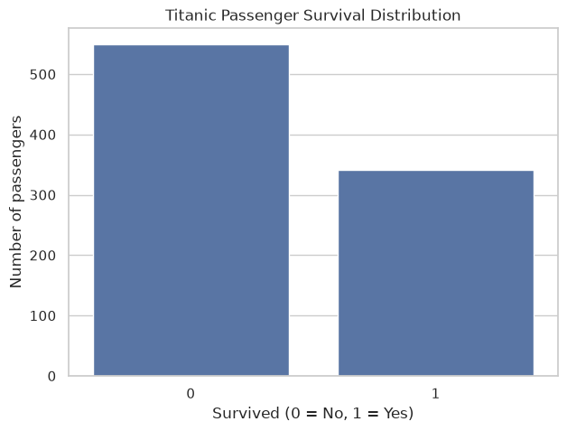
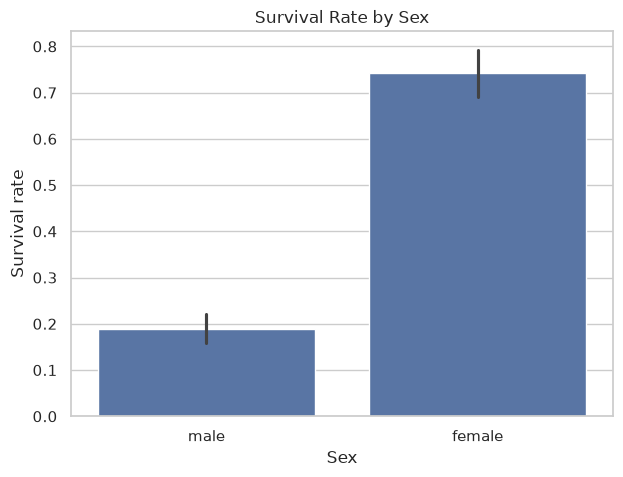
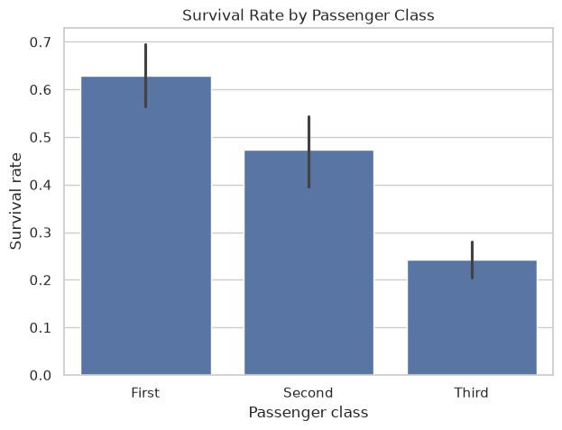

# TITANIC — EXPLORATORY DATA ANALYSIS AND STATISTICAL ANALYSIS

## 1. Introduction

The sinking of the RMS Titanic in April 1912 is one of the most famous maritime disasters in history.

This project aims to analyze passenger data from the Titanic dataset in order to identify patterns and relationships between passenger characteristics and survival outcomes.

The main objective is to apply data analysis, statistical methods and supervised machine learning using Python, Pandas, NumPy, Matplotlib, Seaborn, SciPy and Scikit-learn.

### Research Questions

This analysis focuses on the following questions:

- What proportion of passengers survived?
- Did survival rates differ between male and female passengers?
- Was passenger class associated with survival?
- Was there a statistically significant association between sex and survival?
- How did sex and passenger class jointly relate to survival?
- Can passenger survival be predicted using machine learning?

---

## 2. Dataset Description

The analysis uses the Titanic dataset available through the Seaborn Python library.

The dataset contains information about passengers, including:

- `survived`: survival status (0 = No, 1 = Yes).
- `sex`: passenger's sex.
- `age`: passenger's age.
- `pclass`: passenger class.
- `fare`: ticket fare.
- `embarked`: port of embarkation.

The dataset contains 891 passenger records and 15 variables.

The dataset is loaded directly using:

```python
import seaborn as sns

df = sns.load_dataset("titanic")
```

No raw dataset file is committed to the repository.

---

## 3. Exploratory Data Analysis (EDA)

The exploratory analysis was conducted to understand the dataset's structure, examine variable distributions and identify initial patterns.

The analysis included:

- Dataset inspection.
- Statistical summaries.
- Missing-value examination.
- Duplicate-value examination.
- Survival distribution analysis.
- Survival comparisons by sex and passenger class.

### 3.1 Survival Distribution by Sex

The analysis produced the following results:

| Sex | Survival Rate |
|---|---:|
| Female | 74.20% |
| Male | 18.89% |

**Interpretation:**

Female passengers had a substantially higher survival rate than male passengers.

The difference between the two survival rates is 55.31 percentage points.

This indicates a strong descriptive difference in survival outcomes between the two groups.

### 3.2 Survival Distribution by Passenger Class

| Passenger Class | Survival Rate |
|---|---:|
| First class | 62.96% |
| Second class | 47.28% |
| Third class | 24.24% |

**Interpretation:**

The survival rate decreased from first class to third class.

The difference between first-class and third-class survival rates is 38.72 percentage points.

This suggests that passenger class was associated with survival outcomes.

### 3.3 Survival by Sex and Passenger Class

The analysis also examined survival rates by combining sex and passenger class.

| Sex | Passenger Class | Passengers | Survival Rate |
|---|---|---:|---:|
| Female | First | 94 | 96.81% |
| Female | Second | 76 | 92.11% |
| Female | Third | 144 | 50.00% |
| Male | First | 122 | 36.89% |
| Male | Second | 108 | 15.74% |
| Male | Third | 347 | 13.54% |

**Interpretation:**

The results show differences in survival rates across both sex and passenger class.

Female passengers had higher survival rates than male passengers in all three classes.

Among female passengers, first and second class had particularly high survival rates.

Among male passengers, the survival rate remained comparatively low across all three classes.

These observations suggest that sex and passenger class should both be considered when studying survival outcomes.

---

## 4. Conditional Probability Analysis

Conditional probabilities were calculated to measure the probability of survival given a passenger's sex or class.

The general formula is:

\[
P(A|B)=\frac{P(A\cap B)}{P(B)}
\]

where:

- A represents the event of survival.
- B represents a passenger characteristic.

### 4.1 Survival Probability Given Sex

\[
P(Survival|Female)=\frac{233}{314}=0.7420
\]

\[
P(Survival|Male)=\frac{109}{577}=0.1889
\]

The results confirm that female passengers had a much higher observed survival probability than male passengers.

### 4.2 Survival Probability Given Passenger Class

| Class | Conditional Survival Probability |
|---|---:|
| First | 0.6296 |
| Second | 0.4728 |
| Third | 0.2424 |

The probability of survival decreased across passenger classes, from first to third class.

---

## 5. Contingency Table Analysis

A contingency table was constructed to examine the relationship between sex and survival.

| Sex | Did Not Survive | Survived | Total |
|---|---:|---:|---:|
| Female | 81 | 233 | 314 |
| Male | 468 | 109 | 577 |
| Total | 549 | 342 | 891 |

**Interpretation:**

Among female passengers, 233 survived out of 314.

Among male passengers, 109 survived out of 577.

The table highlights a substantial difference in survival distribution between the two groups.

It also provides the observed frequencies required for the chi-square test of independence.

---

## 6. Statistical Inference: Chi-Square Test

### 6.1 Objective

The chi-square test of independence was performed to determine whether an association existed between sex and survival.

### 6.2 Hypotheses

- Null hypothesis (H0): Sex and survival are statistically independent.
- Alternative hypothesis (H1): Sex and survival are statistically associated.

The significance level was set to:

\[
\alpha=0.05
\]

### 6.3 Mathematical Principle

The chi-square statistic is calculated using:

\[
\chi^2=\sum\frac{(O_{ij}-E_{ij})^2}{E_{ij}}
\]

where:

- \(O_{ij}\) represents observed frequencies.
- \(E_{ij}\) represents expected frequencies under the independence hypothesis.

The expected frequency is calculated as:

\[
E_{ij}=\frac{Row\ Total\times Column\ Total}{Grand\ Total}
\]

### 6.4 Test Results

| Statistical Measure | Result |
|---|---:|
| Chi-square statistic | 260.717 |
| Degrees of freedom | 1 |
| P-value | Approximately 1.20 × 10⁻⁵⁸ |
| Significance level | 0.05 |
| Cramer's V | 0.5409 |

### 6.5 Interpretation

The p-value is substantially lower than the significance threshold of 0.05.

Therefore, the null hypothesis of independence is rejected.

There is strong statistical evidence of an association between sex and survival in this dataset.

Cramer's V is approximately 0.5409, indicating a relatively strong association between the two categorical variables.

These findings support the descriptive observations made earlier.

However, statistical association does not establish causation. Other passenger characteristics and historical circumstances may also have influenced survival outcomes.

---

## 7. Visualizations

### 7.1 Overall Survival Distribution



The visualization shows the distribution of passengers according to their survival status. It provides an overview of the overall mortality and survival rates.

### 7.2 Survival by Sex



The chart highlights the substantial difference in survival rates between female and male passengers. Female passengers had a significantly higher observed survival rate.

### 7.3 Survival by Passenger Class



The visualization shows a decreasing survival rate from first class to third class. This pattern suggests an association between passenger class and survival outcomes.

---

## 8. Predictive Modeling — Logistic Regression

### 8.1 Objective

After completing the exploratory and statistical analyses, a supervised machine learning approach was implemented to predict passenger survival.

The objective was to develop a binary classification model using passenger characteristics as explanatory variables.

The target variable was:

- 0: Passenger did not survive.
- 1: Passenger survived.

Seven explanatory features were selected:

- `sex`
- `pclass`
- `age`
- `fare`
- `sibsp`
- `parch`
- `embarked`

### 8.2 Data Preparation and Preprocessing

The dataset was divided into training and testing sets using an 80/20 split.

Stratified sampling was applied using `stratify=y` to preserve the approximate class distribution in both subsets.

| Dataset | Number of Observations |
|---|---:|
| Training set | 712 |
| Testing set | 179 |
| Total | 891 |

The target distribution was:

| Survival Status | Proportion |
|---|---:|
| Did not survive (0) | 61.62% |
| Survived (1) | 38.38% |

A preprocessing pipeline was implemented to handle numerical and categorical variables separately.

**Numerical features:**

- Missing values were replaced using the median.
- Features were standardized using `StandardScaler`.

**Categorical features:**

- Missing values were replaced using the most frequent category.
- Categorical variables were transformed using `OneHotEncoder` with `drop="first"`.

The preprocessing operations and classification model were integrated into a Scikit-learn Pipeline.

This approach ensures that preprocessing parameters are learned from the training data rather than the test data, helping prevent data leakage.

### 8.3 Logistic Regression Model

A Logistic Regression classifier was implemented using Scikit-learn.

The model was configured with:

```python
LogisticRegression(max_iter=1000)
```

The logistic regression model estimates the probability of survival using the sigmoid function:

\[
P(Y=1|X)=\frac{1}{1+e^{-z}}
\]

where:

\[
z=\beta_0+\beta_1x_1+\cdots+\beta_nx_n
\]

The predicted probability is converted into a binary classification using the default decision threshold of 0.5.

The model was trained using the training dataset and evaluated on the independent test dataset.

### 8.4 Model Performance Evaluation

The model achieved the following results:

| Metric | Result |
|---|---:|
| Accuracy | 79.89% |
| Precision (Class 0) | 81% |
| Recall (Class 0) | 88% |
| F1-score (Class 0) | 84% |
| Precision (Class 1) | 78% |
| Recall (Class 1) | 67% |
| F1-score (Class 1) | 72% |
| ROC-AUC | 0.8436 |

The confusion matrix was:

```text
[[97 13]
 [23 46]]
```

**Interpretation:**

The model correctly classified:

- 97 passengers who did not survive.
- 46 passengers who survived.

However:

- 13 passengers who did not survive were incorrectly classified as survivors.
- 23 passengers who survived were incorrectly classified as non-survivors.

The overall accuracy was approximately 79.89%.

The model achieved a recall of 88% for non-survivors and 67% for survivors.

This indicates that the classifier was better at identifying non-survivors than survivors.

The ROC-AUC score of 0.8436 indicates good discriminative ability between the two classes.

### 8.5 Cross-Validation

To evaluate the stability of the model, a stratified 5-fold cross-validation was performed on the training dataset.

ROC-AUC was selected as the evaluation metric.

The five validation scores were:

| Fold | ROC-AUC |
|---|---:|
| Fold 1 | 0.8559 |
| Fold 2 | 0.8247 |
| Fold 3 | 0.8772 |
| Fold 4 | 0.8307 |
| Fold 5 | 0.8746 |

The summary statistics were:

| Metric | Result |
|---|---:|
| Mean ROC-AUC | 0.8526 |
| Standard deviation | 0.0217 |

**Interpretation:**

The mean ROC-AUC of 0.8526 indicates good average discriminative performance across the five validation folds.

The relatively low standard deviation suggests that the model's performance was reasonably stable across the different validation subsets.

The test ROC-AUC of 0.8436 is close to the cross-validation mean, providing additional evidence of consistent performance.

### 8.6 Interpretation of Logistic Regression Coefficients

The coefficients of the logistic regression model were examined to understand how passenger characteristics were associated with predicted survival odds.

Odds ratios were calculated using:

\[
OR_j=e^{\beta_j}
\]

An odds ratio greater than 1 indicates higher estimated survival odds, while an odds ratio below 1 indicates lower estimated survival odds, relative to the relevant reference category or per standardized numerical feature.

The categorical reference categories were:

- Sex: Female.
- Passenger class: First class.
- Port of embarkation: Cherbourg (C).

The following results were obtained:

| Feature | Coefficient | Odds Ratio |
|---|---:|---:|
| `embarked_Q` | 0.2287 | 1.2569 |
| `fare` | 0.1747 | 1.1909 |
| `parch` | -0.0699 | 0.9325 |
| `sibsp` | -0.2607 | 0.7705 |
| `embarked_S` | -0.4305 | 0.6503 |
| `age` | -0.4689 | 0.6257 |
| `pclass_2` | -0.7349 | 0.4796 |
| `pclass_3` | -1.9197 | 0.1467 |
| `sex_male` | -2.5290 | 0.0797 |

**Main observations:**

**Sex**

The coefficient associated with `sex_male` was negative (-2.5290), with an odds ratio of approximately 0.0797.

This indicates that, holding the other model features constant, male passengers had substantially lower estimated survival odds than female passengers.

**Passenger class**

The odds ratios for second and third class were approximately 0.4796 and 0.1467, respectively.

These results indicate lower estimated survival odds compared with first-class passengers.

**Age**

The age coefficient was negative (-0.4689), with an odds ratio of approximately 0.6257.

Since age was standardized, an increase of one standard deviation in age was associated with a decrease of approximately 37.4% in estimated survival odds, holding other features constant.

**Fare**

The fare coefficient was positive (0.1747), with an odds ratio of approximately 1.1909.

An increase of one standard deviation in fare was associated with an increase of approximately 19.1% in estimated survival odds, holding other features constant.

**Other variables**

The coefficients for `sibsp` and `parch` were negative, suggesting negative conditional associations with survival odds.

The embarkation coefficients also showed differences relative to Cherbourg.

These coefficients represent associations estimated by a regularized logistic regression model. They should not be interpreted as causal effects.

### 8.7 Predictive Modeling Conclusion

The logistic regression model achieved an accuracy of approximately 80% and a test ROC-AUC of 0.8436.

Cross-validation produced a mean ROC-AUC of 0.8526, with a standard deviation of 0.0217.

The coefficient analysis highlighted several important associations between passenger characteristics and predicted survival odds, particularly sex, passenger class and age.

Although the model demonstrated good discriminative performance, its recall for survivors remained relatively low at 67%.

This suggests that further improvements may be possible through decision threshold optimization, feature engineering and comparisons with other classification algorithms.

---

## 9. General Conclusion and Future Work

The exploratory, statistical and predictive analyses of the Titanic dataset revealed several important patterns and relationships between passenger characteristics and survival outcomes.

The exploratory analysis showed that female passengers had substantially higher survival rates than male passengers.

Passenger class was also associated with survival, with first-class passengers experiencing higher survival rates than passengers in second and third class.

The chi-square test provided strong statistical evidence of an association between sex and survival, while Cramer's V indicated a relatively strong association.

The predictive modeling stage demonstrated that logistic regression can provide useful predictions of passenger survival.

The model achieved approximately 79.89% accuracy and a test ROC-AUC of 0.8436.

Cross-validation further indicated reasonably stable discriminative performance.

Overall, this project demonstrates how exploratory data analysis, conditional probability, statistical inference and supervised machine learning can be combined to investigate and predict outcomes using a real-world dataset.

### Future Work

Further development of this project may include:

- Visualizing the ROC curve and confusion matrix.
- Analyzing logistic regression coefficients graphically.
- Optimizing the classification decision threshold.
- Experimenting with additional feature engineering techniques.
- Comparing logistic regression with other classification algorithms, such as Decision Trees, Random Forest and Support Vector Machines.
- Evaluating model performance using additional metrics and validation strategies.

These experiments will help assess whether alternative approaches can improve predictive performance and generalization.

---

## 10. Technologies Used

- Python
- Pandas
- NumPy
- Matplotlib
- Seaborn
- SciPy
- Scikit-learn
- Git
- GitHub