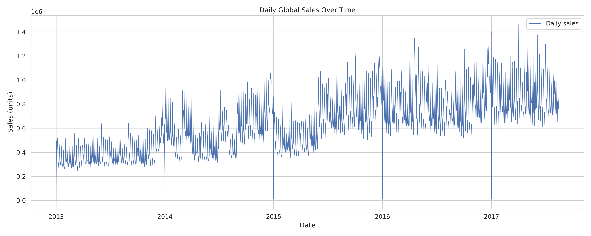
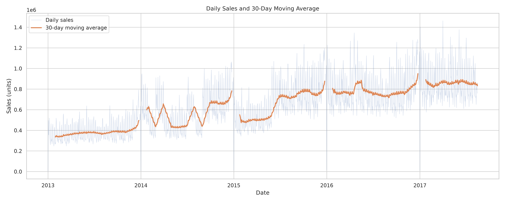
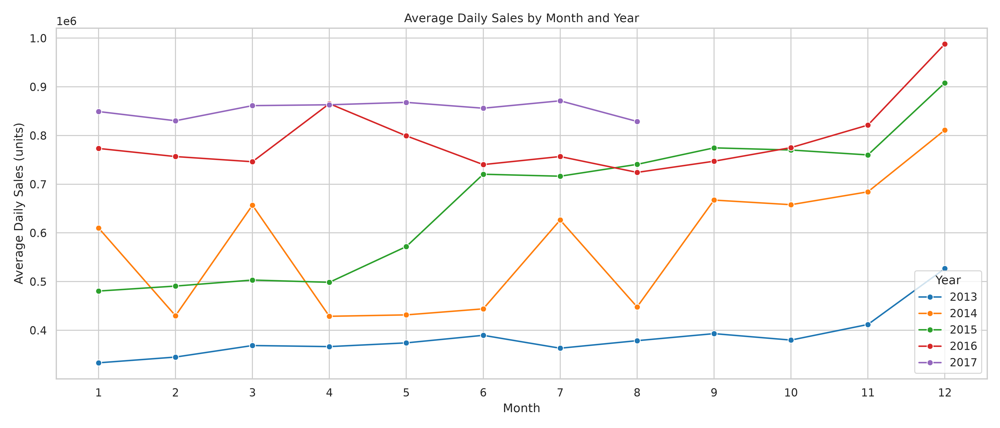
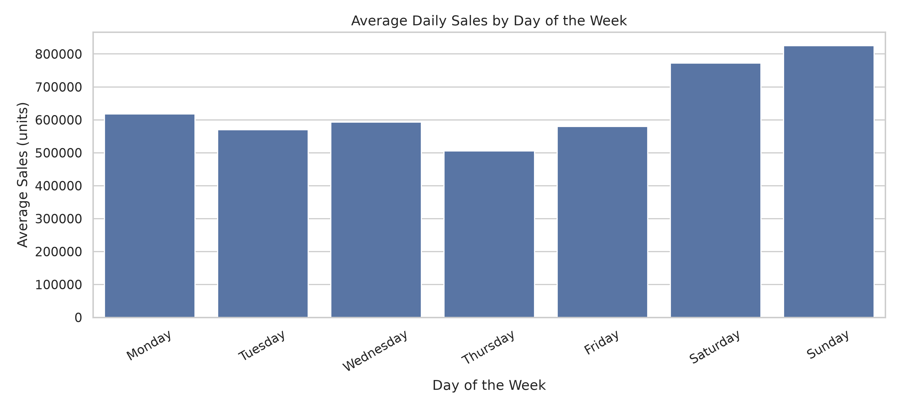
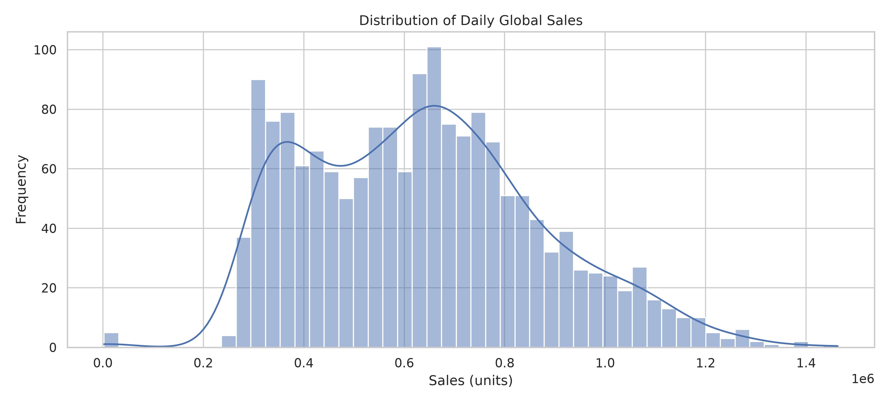
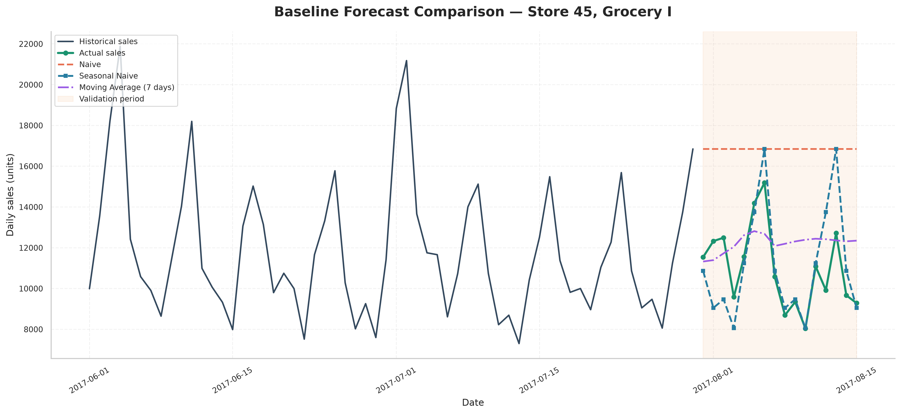
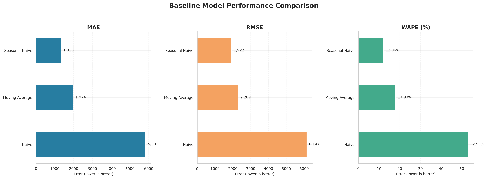

# SALES FORECASTING — TECHNICAL REPORT

## Table of Contents

1. [Introduction](#1-introduction)
2. [Business Problem and Forecasting Objectives](#2-business-problem-and-forecasting-objectives)
3. [Dataset Description](#3-dataset-description)
4. [Initial Data Inspection and Quality Assessment](#4-initial-data-inspection-and-quality-assessment)
5. [Data Preparation](#5-data-preparation)
6. [Exploratory Time Series Analysis](#6-exploratory-time-series-analysis)
7. [Forecasting Methodology](#7-forecasting-methodology)
8. [Model Evaluation](#8-model-evaluation)
9. [Results and Discussion](#9-results-and-discussion)
10. [Conclusion](#10-conclusion)

---

## 1. Introduction

Sales forecasting is an important analytical task in the retail industry. Accurate predictions of future demand help businesses improve inventory management, optimize supply chain operations, and support strategic decision-making.

This project investigates historical retail sales data from Corporación Favorita, an Ecuadorian grocery retailer, with the objective of developing time series forecasting models.

The analysis focuses on identifying temporal patterns, understanding sales behavior, and evaluating statistical and machine learning approaches for predicting future sales.

The project follows a progressive methodology, beginning with data inspection and preparation before moving towards exploratory time series analysis and predictive modeling. This report documents the completed data-preparation, exploratory-analysis and baseline-forecasting stages. More advanced statistical and machine learning models remain part of the planned continuation of the project.

## 2. Business Problem and Forecasting Objectives

### 2.1 Business Problem

Retail sales are influenced by several factors, including historical demand, seasonal patterns, promotional activities, holidays, and external economic conditions.

Understanding these factors is essential for producing reliable sales forecasts.

The central problem addressed in this project is:

**How can historical retail sales data be used to predict future sales while accounting for temporal patterns and relevant external factors?**

### 2.2 Objectives

The main objectives are:

- Analyze historical sales behavior across stores and product families.
- Identify trends, seasonal patterns, and temporal variations.
- Investigate temporal patterns and the potential relevance of promotions, holidays, and oil prices.
- Prepare reliable datasets for time series modeling.
- Develop and evaluate baseline forecasting approaches.
- Establish a reproducible benchmark for subsequent statistical and machine learning models.

The current forecasting experiment is deliberately limited to baseline methods. The explanatory variables listed above have not yet been incorporated into the forecasting models; their use is reserved for subsequent development.

The target variable is `sales`, which represents the number of units sold rather than monetary revenue.

## 3. Dataset Description

### 3.1 Data Source

The dataset used in this project comes from the Kaggle competition:

**Store Sales — Time Series Forecasting**

The dataset contains historical retail information from 54 stores in Ecuador.

It provides daily sales observations for multiple product families, together with additional information about stores, transactions, promotions, holidays, and oil prices.

### 3.2 Dataset Components

The following files were used for the initial inspection:

| Dataset | Rows | Columns | Description |
|---|---:|---:|---|
| train.csv | 3,000,888 | 6 | Historical sales observations |
| test.csv | 28,512 | 5 | Forecasting observations |
| stores.csv | 54 | 5 | Store characteristics |
| oil.csv | 1,218 | 2 | Daily oil prices |
| holidays_events.csv | 350 | 6 | Holidays and events |
| transactions.csv | 83,488 | 3 | Daily transactions per store |
| sample_submission.csv | 28,512 | 2 | Example submission structure |

### 3.3 Temporal Coverage

The training dataset covers the period from January 1, 2013, to August 15, 2017.

The test dataset covers the period from August 16, 2017, to August 31, 2017.

Consequently, the forecasting horizon consists of 16 consecutive calendar days.

The training dataset contains 1,684 distinct dates, while the test dataset contains 16 distinct dates.

### 3.4 Data Granularity

Each observation in the training dataset represents the sales volume associated with a specific combination of:

- Date (`date`)
- Store (`store_nbr`)
- Product family (`family`)

The business key is therefore:

`(date, store_nbr, family)`

The target variable is `sales`, while `onpromotion` represents the number of items on promotion for the corresponding observation.

## 4. Initial Data Inspection and Quality Assessment

### 4.1 Inspection Methodology

An initial inspection was performed using Python and Pandas.

The objective was to assess the structure, completeness, consistency, and temporal coverage of the original datasets before applying any transformations.

The following checks were conducted:

- Dataset dimensions and column types.
- Missing-value detection.
- Exact duplicate detection.
- Date coverage and number of distinct dates.
- Number of distinct stores and product families.
- Business key uniqueness.
- Sales distribution and identification of zero or negative values.

No cleaning or imputation was performed during this initial inspection.

### 4.2 Structural Integrity

The training dataset contains 3,000,888 observations and six columns.

The test dataset contains 28,512 observations and five columns.

The training and test datasets both contain:

- 54 distinct stores.
- 33 distinct product families.

No exact duplicate rows were detected in either dataset.

Furthermore, no duplicate business keys were identified using the combination `(date, store_nbr, family)`.

This confirms that each available store-product-family-date combination is represented by a unique observation.

### 4.3 Missing Values

No missing values were detected in the training or test datasets.

However, the oil dataset contains 43 missing values in the `dcoilwtico` variable.

These missing observations require further investigation before any imputation strategy can be selected.

The absence of oil price observations may be related to non-trading days and market holidays. Nevertheless, this explanation should be verified before treating all missing values in the same way.

### 4.4 Missing Calendar Dates

The training dataset contains four dates that are absent from its temporal coverage:

- December 25, 2013.
- December 25, 2014.
- December 25, 2015.
- December 25, 2016.

All four dates correspond to Christmas Day.

These dates are absent from the training dataset rather than being represented by observations with zero sales.

This distinction is important because an absent date should not automatically be interpreted as a zero-sales observation.

The missing dates will therefore be considered explicitly during temporal data preparation.

No artificial observations have been introduced at this stage.

### 4.5 Sales Distribution

The initial inspection revealed the following sales distribution:

| Indicator | Number of observations |
|---|---:|
| Zero sales | 939,130 |
| Positive sales | 2,061,758 |
| Negative sales | 0 |
| Total observations | 3,000,888 |

Zero-sales observations represent approximately 31.29% of the training dataset, while positive-sales observations account for approximately 68.71%.

No negative sales values were detected.

The minimum sales value is 0, and the maximum is 124,717 units.

The relatively high proportion of zero-sales observations highlights the importance of understanding demand patterns at the store and product-family levels.

These observations will be retained during subsequent analyses unless a specific data-quality issue is identified.

The maximum observed value will also be examined during exploratory analysis to determine whether it represents an unusual but valid sales observation.

### 4.6 Initial Data Quality Summary

The initial inspection indicates that the datasets have a generally consistent structure.

The main findings are:

- No missing values in the training and test datasets.
- No exact duplicate observations.
- No duplicate business keys.
- Four missing calendar dates in the training period, all corresponding to Christmas Day.
- A significant proportion of zero-sales observations.
- Forty-three missing oil price observations requiring further investigation.

These findings provide a basis for the next stage of the project: data preparation and temporal aggregation.

## 5. Data Preparation

### 5.1. Date Conversion and Chronological Ordering

The date column was converted to the appropriate datetime format to support time-based operations and chronological analysis.

The observations were then organized in ascending chronological order to ensure consistency throughout the time series analysis and forecasting process.

### 5.2. Daily Sales Aggregation

For the initial global time series analysis, sales were aggregated at the daily level across all stores and product families.

The daily sales series was obtained by summing the sales recorded for each date:

\[
Sales_t = \sum_{i=1}^{N_t} Sales_{i,t}
\]

where \(N_t\) represents the number of store-family observations available on day \(t\).

This aggregation provided a global overview of daily sales activity across the dataset. It is important to distinguish this global exploratory series from the forecasting experiment in Sections 7–9, which uses only Store 45 – GROCERY I.

### 5.3. Complete Calendar Construction

A continuous daily calendar was constructed between the first and last dates of the training dataset.

The aggregated daily sales series was subsequently reindexed against this complete calendar. This operation made it possible to identify dates for which no sales observations were recorded.

Four missing calendar dates were identified:

- December 25, 2013
- December 25, 2014
- December 25, 2015
- December 25, 2016

These dates correspond to Christmas Day.

Importantly, missing observations were preserved as missing values rather than automatically replaced with zero. A missing observation does not necessarily indicate that no sales occurred; it indicates that no corresponding observation was available in the original dataset.

### 5.4. Missing Observation Identification

An additional binary indicator, `is_observed`, was introduced to distinguish dates with recorded sales from dates without observations.

This indicator facilitates the identification of missing calendar observations and prevents them from being confused with genuine zero-sales days.

The distinction is important for subsequent statistical analysis and forecasting because missing observations and zero sales have different meanings.

### 5.5. Preparation of the Forecasting Series

For the initial baseline forecasting experiment, a specific store-family combination was selected:

- Store: 45
- Product family: GROCERY I

Daily sales for this combination were extracted from the original training dataset and organized chronologically.

A complete daily calendar was then constructed for the selected series. It contains 1,688 calendar days from January 1, 2013, to August 15, 2017, of which 1,684 have recorded sales and four are missing observations. These four dates are retained as missing values rather than being interpreted as zero-sales days.

The training calendar contains 1,672 days, including the four missing observations. The 16-day validation period contains no missing observations. The final seven training dates used by the Seasonal Naive model (July 24–30, 2017) are all observed, so its reference weekly profile is complete.

The resulting series was divided chronologically into two periods:

- **Training period:** January 1, 2013 – July 30, 2017.
- **Validation period:** July 31, 2017 – August 15, 2017.

The validation period contains 16 consecutive days and was kept separate from the training data to evaluate the forecasting models on observations not used during model construction.

No future validation sales were used to generate the forecasts.

### 5.6. Data Preparation Considerations

The preparation process followed several principles:

- Preserve the chronological structure of the observations.
- Distinguish missing observations from genuine zero-sales values.
- Avoid introducing artificial sales values through automatic missing-value replacement.
- Maintain a strict temporal separation between training and validation periods.
- Ensure that all baseline models are evaluated on the same validation observations.

These preparation steps establish a consistent foundation for exploratory time series analysis and baseline forecasting.

## 6. Exploratory Time Series Analysis

### 6.1. Daily Sales Evolution

The daily sales time series was examined to understand the overall behavior of sales activity throughout the observation period.

A time series plot was generated to visualize daily sales fluctuations and identify potential changes in the level and variability of sales over time.

**Figure 1 — Daily Sales Evolution**

The visualization provides an overview of the temporal dynamics of sales. It should be read as a global series: it aggregates all stores and product families, so its level and fluctuations are not directly comparable with the Store 45 – GROCERY I series used later for forecasting. The plot is useful for locating periods of changing sales levels and volatility, while the smoothed and grouped views below help examine these patterns at different time scales.

### 6.2. Sales Trend Analysis Using a Moving Average

A 30-day moving average was calculated to smooth short-term fluctuations and make the underlying sales trend easier to examine.

Unlike the original daily series, which can exhibit substantial day-to-day variability, the moving average provides a smoother representation of the evolution of sales.

**Figure 2 — Daily Sales Trend (30-Day Moving Average)**

The moving average reduces the visual impact of day-to-day variation and makes broader movements easier to inspect. It is a descriptive smoothing operation, not a forecasting model, and it should not be interpreted as evidence of a causal explanation for changes in sales.

### 6.3. Monthly Sales Patterns

Monthly sales patterns were examined to investigate potential variations in sales activity across calendar months.

Daily sales were grouped by month to facilitate comparisons and identify possible recurring seasonal behavior.

**Figure 3 — Monthly Sales Patterns**

The monthly comparison helps identify differences in sales levels across calendar months. A recurring annual seasonal effect, however, would require consistent evidence across multiple years; a difference in a single month or year is not sufficient to establish annual seasonality. The figure is therefore treated as exploratory evidence rather than proof of a stable seasonal component.

### 6.4. Weekly Sales Patterns

Weekly sales patterns were investigated by grouping daily observations according to their corresponding day of the week.

This analysis was designed to identify recurring differences in sales activity between weekdays and weekends.

**Figure 4 — Weekly Sales Pattern**

The weekly comparison is particularly relevant to the forecasting stage because it examines whether sales levels differ systematically by day of the week. This provides a rationale for testing a seven-day Seasonal Naive benchmark. The model choice is subsequently assessed quantitatively on the separate Store 45 – GROCERY I validation series; the global weekly chart alone does not establish that the same pattern holds for every store-family combination.

### 6.5. Sales Distribution Analysis

The distribution of daily sales was examined to understand the dispersion of observations and identify potentially extreme values.

**Figure 5 — Sales Distribution**

The distribution analysis complements the temporal visualizations by showing how frequently different daily sales levels occur and whether the distribution is concentrated or spread across a wide range. Extreme values should be investigated in their temporal and business context rather than removed solely because they are statistically unusual.

### 6.6. Investigation of Extreme Sales Observations

Potentially extreme sales observations were identified and investigated to better understand their contribution to overall sales activity.

Additional analyses examined sales at the store and product-family levels to determine whether unusually high global sales values were associated with specific business segments.

A focused investigation was also conducted for Store 45 and the GROCERY I product family around April 18, 2016. The surrounding daily observations were examined to place the date in context rather than treating a single high or unusual value in isolation.

This store-family investigation is distinct from the global extreme-sales analysis and provides a closer look at the type of series later selected for the baseline forecasting experiment. Extreme observations were treated as points requiring investigation rather than automatically classified as data errors. No observation was removed solely on the basis of its magnitude.

### 6.7. Exploratory Analysis Summary

The exploratory analysis established a descriptive view of daily sales at the global level by examining temporal fluctuations, a 30-day smoothed trend, monthly variation, day-of-week patterns, the distribution of daily sales and potentially extreme observations.

The analysis is exploratory: it identifies structures worth investigating but does not, by itself, establish causal relationships or prove that a pattern is stable across every store and product family. In particular, the weekly view motivated the inclusion of a seven-day Seasonal Naive benchmark, whose predictive value was then tested separately on Store 45 – GROCERY I.

The next section therefore moves from global description to a clearly defined pilot forecasting experiment.

## 7. Forecasting Methodology

### 7.1. Forecasting Experimental Setup

The initial forecasting experiment focused on the daily sales series of Store 45 for the GROCERY I product family. Unlike the global aggregation used in the exploratory analysis, this experiment uses one store-family combination only.

The forecasting task was formulated as a univariate time series prediction problem, with daily sales as the target variable. The complete historical calendar contains four missing observations; these are not treated as zero sales. The final seven-day seasonal reference window is fully observed, and all 16 validation targets are available.

The experiment used a chronological training-validation split:

| Dataset | Period | Number of Days |
|---|---|---:|
| Training | January 1, 2013 – July 30, 2017 | 1,672 |
| Validation | July 31, 2017 – August 15, 2017 | 16 |

The objective was to predict daily sales over a 16-day forecasting horizon.

Three baseline forecasting models were implemented and evaluated using the same training and validation periods.

### 7.2. Naive Forecast

The Naive Forecast model assumes that the most recently observed value remains unchanged throughout the forecasting horizon.

Its forecasting equation is:

\[
\hat{y}_{T+h}=y_T
\]

where:

- \(y_T\) represents the last observed training value.
- \(h\) represents the forecasting horizon.
- \(\hat{y}_{T+h}\) represents the predicted sales value.

For this experiment, the last observed training value was 16,847 units on July 30, 2017.

Consequently, the model generated a constant forecast of 16,847 units for each of the 16 validation days.

This model provides a simple reference against which more sophisticated forecasting approaches can be evaluated.

### 7.3. Seasonal Naive Forecast

The Seasonal Naive model assumes that sales follow a recurring seasonal pattern.

Given the weekly nature of retail activity, a seasonal period of seven days was selected.

The forecasting equation is:

\[
\hat{y}_{T+h}
=
y_{T+h-7\lceil h/7\rceil}
\]

where:

- \(T\) represents the last training observation.
- \(h\) represents the forecasting horizon.
- The seasonal period is seven days.

The model uses the last complete seven-day cycle from July 24 to July 30, 2017, as its reference pattern.

For forecasting horizons longer than seven days, the same weekly cycle is repeated.

This approach explicitly incorporates recurring day-of-week behavior without requiring parameter estimation.

### 7.4. Moving Average Forecast

The Moving Average model generates predictions using the arithmetic mean of the most recent seven available values.

The forecasting equation is:

\[
\hat{y}_{T+h}
=
\frac{1}{7}
\sum_{i=1}^{7}z_{T+h-i}
\]

where \(z\) represents either an observed historical value or a previously generated forecast.

A seven-day window was selected to capture short-term sales behavior over one complete weekly cycle.

For multi-step forecasting, a recursive strategy was implemented:

1. Calculate the mean of the last seven available values.
2. Generate the next forecast.
3. Append the forecast to the historical sequence.
4. Use the updated sequence to calculate the following prediction.
5. Repeat until the entire 16-day horizon is covered.

Importantly, actual validation observations were never incorporated into the recursive forecasting process.

This ensures that the model does not benefit from information that would not have been available at the time of prediction.

### 7.5. Model Implementation and Reproducibility

All three baseline models were implemented in Python using NumPy and Pandas.

The forecasting implementation was organized around common configuration parameters, including:

- Training cutoff date.
- Validation start and end dates.
- Forecasting horizon.
- Seasonal period.
- Moving average window.

The same validation observations were used to evaluate all three models, ensuring a consistent comparison.

The generated predictions and evaluation results were saved as CSV files to support reproducibility and subsequent analysis.

### 7.6. Baseline Modeling Strategy

The baseline models serve as reference points for assessing the predictive value of more advanced forecasting approaches.

The Naive model establishes a simple persistence benchmark.

The Seasonal Naive model introduces weekly seasonal information.

The Moving Average model provides a smoothed representation of recent sales behavior.

Their comparative performance will guide the selection and development of subsequent forecasting approaches.

## 8. Model Evaluation

### 8.1 Evaluation Metrics

The three baseline forecasting models were evaluated on the same 16-day validation period, from July 31 to August 15, 2017.

Three complementary metrics were selected:

**Mean Absolute Error (MAE)** measures the average absolute difference between actual and predicted sales.

\[
MAE = \frac{1}{n}\sum_{i=1}^{n}|y_i-\hat{y}_i|
\]

**Root Mean Squared Error (RMSE)** measures the square root of the average squared prediction errors. Because errors are squared before averaging, RMSE gives greater weight to larger forecasting errors.

\[
RMSE = \sqrt{\frac{1}{n}\sum_{i=1}^{n}(y_i-\hat{y}_i)^2}
\]

**Weighted Absolute Percentage Error (WAPE)** expresses the total absolute forecasting error as a percentage of total actual sales.

\[
WAPE = \frac{\sum_{i=1}^{n}|y_i-\hat{y}_i|}{\sum_{i=1}^{n}|y_i|}\times 100
\]

MAPE was not selected because it can become undefined or misleading when actual sales values are zero or close to zero.

For all three metrics, lower values indicate better forecasting performance.

### 8.2 Baseline Model Comparison

The following results were obtained on the validation period:

| Model | MAE | RMSE | WAPE |
|---|---:|---:|---:|
| Seasonal Naive | 1,328.31 | 1,922.29 | 12.06% |
| Moving Average (7-day) | 1,974.28 | 2,288.67 | 17.93% |
| Naive | 5,832.94 | 6,146.91 | 52.96% |

**Figure 6 — Baseline Forecast Comparison**

The forecast comparison places the three model predictions alongside the observed validation sales. It makes it possible to assess how each baseline follows, or fails to follow, the day-to-day movements during the 16-day horizon.

**Figure 7 — Baseline Model Performance**

The performance chart compares the three models using MAE, RMSE and WAPE. The numerical results underlying the chart are available in `outputs/tables/baseline_model_comparison.csv`.

### 8.3 Interpretation of Results

The Seasonal Naive model achieved the best performance across all three evaluation metrics, with an MAE of 1,328.31 units, an RMSE of 1,922.29 units and a WAPE of 12.06%.

The Moving Average model ranked second, while the standard Naive model produced the largest forecasting errors.

Compared with the Moving Average model, the Seasonal Naive model reduced MAE by approximately 32.7%. Compared with the standard Naive model, the reduction was approximately 77.2%. The same ranking is observed for RMSE and WAPE, so the conclusion does not depend on selecting only one error metric.

The Seasonal Naive model's RMSE is approximately 16.0% lower than that of the Moving Average model and 68.7% lower than that of the Naive model. This is consistent with the MAE and WAPE comparison and indicates that the Seasonal Naive model also reduces the squared-error penalty associated with larger misses.

These results suggest that, for the selected Store 45 – GROCERY I series, repeating the most recent weekly sales pattern provides a more effective baseline than simply repeating the last observed value or using a recursive seven-day moving average. The evidence supports this conclusion for this series and this validation window only; it does not establish universal superiority across the full retail dataset.

The Seasonal Naive model's WAPE of 12.06% means that the sum of its absolute forecasting errors represents approximately 12.06% of the total actual sales volume over the validation period. It should not be interpreted as the percentage error on every individual day.

### 8.4 Evaluation Scope

These results concern one store-family combination and one 16-day validation period. They provide an initial comparison of baseline forecasting methods, but they are not sufficient to establish that Seasonal Naive will perform best across all stores and product families.

Further evaluation across additional store-family series and more validation periods will be necessary before drawing broader conclusions.

## 9. Results and Discussion

### 9.1 Main Findings

The baseline forecasting experiment shows that, for the selected Store 45 – GROCERY I series and the 16-day validation window, the most recent weekly sales profile was a more useful forecasting reference than either the last single observation or a recursively updated seven-day average.

Among the three evaluated approaches, the Seasonal Naive model achieved the lowest forecasting errors across MAE, RMSE and WAPE. This is evidence that the latest observed weekly profile contained useful predictive information for this particular short-term forecasting task. It is not proof that weekly seasonality is equally strong in every store or product family.

The Moving Average model performed better than the standard Naive model but did not capture the weekly structure as effectively as the Seasonal Naive approach.

The standard Naive model produced the weakest results. Repeating the last observed value throughout the forecasting horizon did not adequately represent the fluctuations in daily sales.

### 9.2 Implications for Forecasting

The results suggest that a forecasting model should account for recurring temporal patterns rather than relying exclusively on the most recent observation.

In retail sales forecasting, weekly seasonality is a particularly relevant structure to investigate because customer purchasing behaviour may vary depending on the day of the week.

The performance of the Seasonal Naive model provides an initial indication that this structure is useful for the selected series. It also establishes a reference point against which more advanced forecasting approaches can be evaluated.

### 9.3 Limitations

Several limitations must be considered when interpreting these results:

- **Limited evaluation scope:** the experiment focuses on a single store-family combination rather than the complete dataset.
- **Short validation horizon:** performance was measured over only 16 consecutive days.
- **Limited historical structure:** the baseline models do not explicitly account for long-term trends, changing seasonal patterns or external influences.
- **No explanatory variables:** promotions, holidays, oil prices, transactions and store characteristics are not incorporated into these baseline forecasting methods.
- **Potential variation across series:** different stores and product families may exhibit different sales behaviours and forecasting requirements.

Consequently, the results should be interpreted as an initial baseline experiment rather than a general assessment of forecasting performance across the entire retail network.

### 9.4 Directions for Improvement

The next stage will investigate more advanced forecasting approaches and assess whether they improve upon the baseline results.

Potential directions include:

- Incorporating explanatory variables such as promotions, holidays and transactions.
- Investigating trend and seasonal components in greater detail.
- Evaluating forecasting methods across multiple store-family combinations.
- Comparing model performance over different validation periods.
- Assessing whether more advanced models provide consistent improvements over the Seasonal Naive baseline.

These investigations will help determine whether additional model complexity produces meaningful forecasting gains.

## 10. Conclusion

This project investigates retail sales forecasting using the Corporación Favorita Store Sales dataset.

The work began with data inspection and preparation, followed by exploratory time series analysis to understand the structure and behaviour of daily sales. A dedicated forecasting experiment was then conducted using Store 45 – GROCERY I as a pilot series.

Three baseline forecasting approaches were implemented and evaluated: Naive, Seasonal Naive and a seven-day Moving Average.

The Seasonal Naive model achieved the best results on the selected validation period, outperforming the other two baseline approaches across MAE, RMSE and WAPE. On this pilot series, the result demonstrates the practical value of using a recent weekly profile as a short-term forecasting benchmark. It should not be generalized beyond the tested store-family combination and validation period without further evaluation.

However, the experiment remains limited to one store-family combination and a 16-day validation period. Further testing across multiple series, together with the integration of relevant explanatory variables, will be necessary to assess the robustness and generalizability of the results.

Overall, this project establishes a reproducible forecasting baseline and provides a foundation for more advanced time series modelling and evaluation.